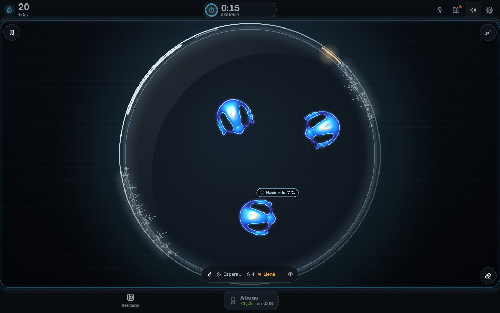
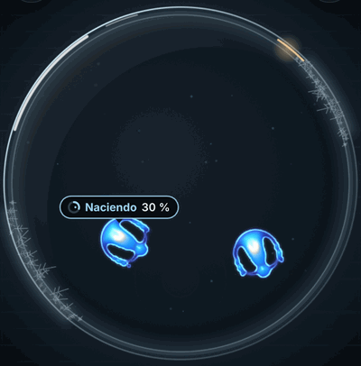
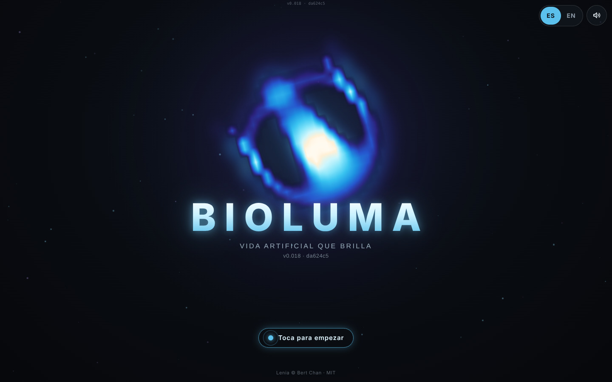
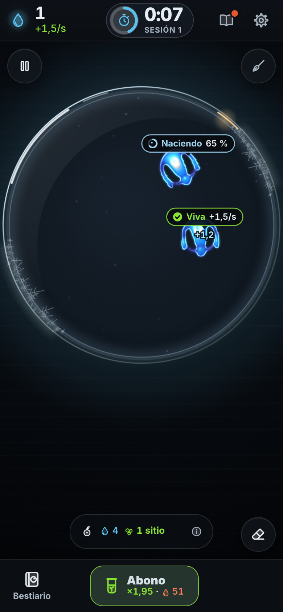
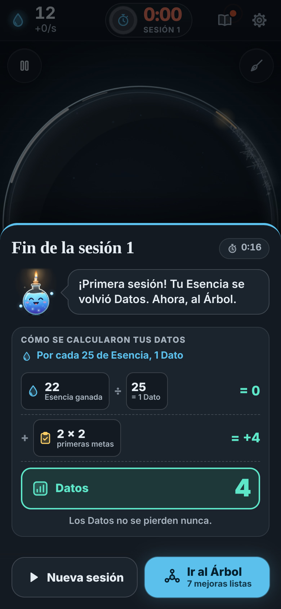
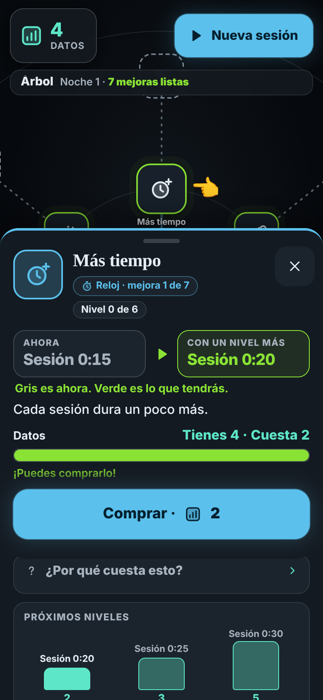
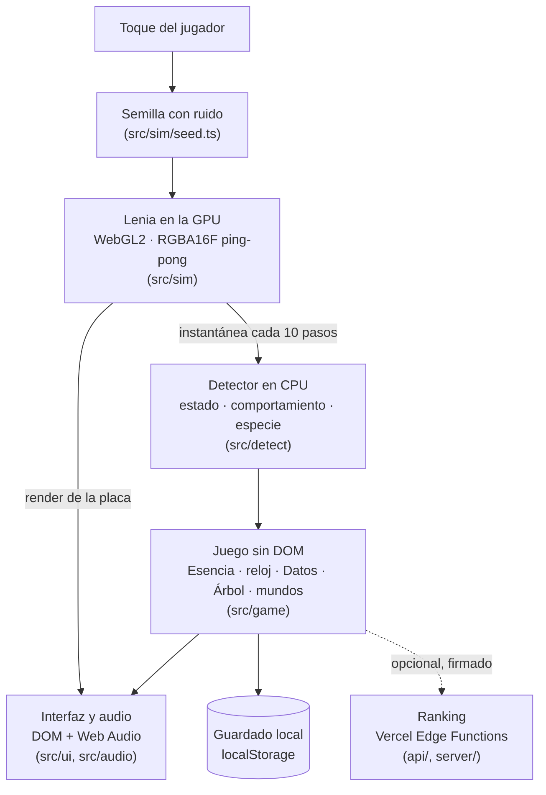

<h1 align="center">Bioluma</h1>

<p align="center"><b>Siembras luz y nace vida artificial de verdad:</b> un juego incremental donde cada criatura es <a href="https://github.com/Chakazul/Lenia">Lenia</a> simulada en vivo en la GPU de tu navegador.</p>

<p align="center">
  <a href="https://bioluma-xi.vercel.app"></a>
  <a href="https://github.com/ronalc90/Lenia/actions/workflows/ci.yml"></a>
  <a href="LICENSE"></a>
  
  
  
  
</p>

<p align="center"><b>Español</b> · <a href="#english">English</a> · <a href="https://github.com/ronalc90/Lenia/wiki">Wiki</a></p>

<p align="center">
  <a href="https://bioluma-xi.vercel.app"></a>
  <br><sub><i>Sesión 1 en el sitio publicado: tres criaturas Lenia naciendo en la placa de Petri. Nada está animado a mano.</i></sub>
</p>

## Qué es

Imagina una cuadrícula de lucecitas, cada una con un brillo entre 0 (apagada) y 1 (encendida). En cada paso, cada lucecita mira a sus vecinas en un anillo a su alrededor: si lo que ve le "gusta", brilla un poco más; si no, se apaga un poco. Repite esa sola regla en todas las lucecitas a la vez, decenas de veces por segundo, y aparecen manchas de luz que **nadan, giran y laten solas**. Eso es **vida artificial**: nadie programó cómo se mueve cada criatura, el movimiento *emerge* de la regla. La regla se llama **Lenia**, la creó Bert Wang-Chak Chan, y Bioluma la convierte en un juego: tocas la placa para sembrar, miras qué sobrevive, las criaturas estables te dan **Esencia** y, al final de cada sesión corta, esa Esencia se vuelve **Datos** para comprar mejoras. Es gratis, sin anuncios, sin cuenta y se juega con un dedo.

<p align="center">
  
  <br><sub>Fotogramas reales del sitio publicado: las semillas pasan de "Naciendo" a "Viva" y la criatura nada sola por la placa.</sub>
</p>

## Qué puedes hacer

- **Sembrar con un toque.** Cada semilla lleva ruido asimétrico: muchas se disuelven y algunas cobran vida. En la primera sesión las tres primeras semillas siempre viven, para que nadie empiece con la placa vacía.
- **Jugar sesiones cortas de laboratorio.** La primera dura **15 segundos** y el reloj arranca con tu primera gota; la ruta Reloj del Árbol la alarga hasta **2:30**.
- **Convertir Esencia en Datos.** Al sonar "¡Tiempo!" la placa se congela y un resumen muestra la cuenta completa.
- **Crecer el Árbol de investigación:** 54 nodos en **7 rutas rectas** (Reloj, Gotero, Placa, Vida, Descubrir, Mundos, Destello). Cada compra muestra el "antes → después".
- **Abrir 7 mundos.** Cada mundo es otra combinación de parámetros de Lenia (μ, σ, radio, anillos) y hace nacer otra especie; en Gigantes las criaturas son tan grandes que caben la mitad y valen el doble.
- **Llenar el Bestiario.** Un detector reconoce cada criatura estable comparando su firma con el catálogo de Bert Chan (26 especies curadas); cada especie nueva queda para siempre.
- **Avanzar noches e historia.** VELA te acompaña, te pide Encargos durante las sesiones y cada pocas sesiones la noche avanza gratis: se abren mejoras nuevas y nunca se borra nada.
- **Atrapar el Destello dorado**, cumplir objetivos y logros permanentes y buscar [secretos](https://github.com/ronalc90/Lenia/wiki/Secretos) (sin spoilers).
- **Ver una placa redonda que crece**, con borde de vidrio que absorbe y desvía a las nadadoras.
- **Competir en un ranking global opcional:** no se envía nada hasta que eliges un nombre, y cada envío va firmado ([`docs/RANKING.md`](docs/RANKING.md)).
- **Llevarte la partida:** guardado local automático y, en **Ajustes**, los botones **Exportar** e **Importar** para pasarla a otro aparato.
- **Jugar como prefieras:** español e inglés, tema oscuro y claro, "Reducir movimiento", "Modo un toque" y botones de al menos 48 px. Es una PWA instalable con service worker para abrir sin conexión.
- **Escuchar audio sintetizado en vivo** con Web Audio: no hay archivos de sonido ni arte generado por IA.

## Capturas

Todas son del sitio publicado ([bioluma-xi.vercel.app](https://bioluma-xi.vercel.app), v0.018), jugado con toques en un navegador sin pantalla.

<p align="center">
  
  <br><sub>La pantalla de título: el emblema es el patrón real de <i>Orbium</i> del catálogo de Lenia, no un logo dibujado.</sub>
</p>

<table>
  <tr>
    <td align="center" width="33%"><br><sub>En el teléfono: una criatura ya viva da Esencia y otra está naciendo.</sub></td>
    <td align="center" width="33%"><br><sub>Fin de la sesión: la Esencia se vuelve Datos, con la cuenta a la vista.</sub></td>
    <td align="center" width="33%"><br><sub>El Árbol: cada mejora muestra el antes y el después.</sub></td>
  </tr>
</table>

## Cómo funciona

1. **Simulación en la GPU** ([`src/sim/`](src/sim)). La placa es una textura `RGBA16F` que se actualiza en *ping-pong* con shaders de WebGL2. Cada paso aplica la regla de Chan: `A ← clip01(A + dt · G(K * A))`, con un núcleo en anillo de perfil `(4r(1−r))⁴` y crecimiento `G(u) = 2·max(0, 1 − (u−μ)²/(9σ²))⁴ − 1`. Una referencia en CPU con FFT (`cpu.ts`) usa las mismas fórmulas para las pruebas y los bots.
2. **Detector en CPU** ([`src/detect/`](src/detect)). Cada 10 pasos se lee una instantánea de la placa (nunca `readPixels` por fotograma). El detector separa las manchas, las sigue entre lecturas y decide su estado (naciendo, estable, explotó, muerta), su comportamiento (quieta, late, nada, gira…) y su especie por firma.
3. **Juego sin DOM** ([`src/game/`](src/game)). Solo las criaturas estables pagan Esencia (una sopa uniforme da 0). El reloj de sesión, la conversión a Datos, el Árbol, los mundos y las noches son funciones puras; todos los números de balance viven en [`src/game/balance.ts`](src/game/balance.ts) y [`src/game/cycleBalance.ts`](src/game/cycleBalance.ts).
4. **Interfaz y audio** ([`src/ui/`](src/ui), [`src/audio/`](src/audio)). TypeScript y DOM sin framework; el sonido se sintetiza con Web Audio a partir de los eventos del juego.
5. **Integración** ([`src/main.ts`](src/main.ts)). Une todo en el bucle de `requestAnimationFrame` y guarda la partida en `localStorage`.



Las decisiones de diseño (por qué la placa es redonda, por qué `RGBA16F`, por qué la firma de especie no usa μ ni σ…) están en [`DECISIONS.md`](DECISIONS.md) como ADR.

## Stack

| Pieza | Tecnología |
|---|---|
| Lenguaje | TypeScript en modo `strict` |
| Empaquetado | Vite (`vite-plugin-singlefile` para la build de un solo archivo) |
| Simulación y render | WebGL2 (shaders GLSL, texturas `RGBA16F`) |
| Interfaz | DOM y CSS sin framework |
| Audio | Web Audio API, todo sintetizado en tiempo de ejecución |
| Pruebas | Vitest (unitarias) y `playwright-core` (navegador) |
| Dependencias de ejecución | **Cero**: el `package.json` solo tiene dependencias de desarrollo |
| Hosting | Vercel (sitio y funciones Edge del ranking) |
| Otras plataformas | Electron (escritorio y Steam) y Capacitor (Android) en [`platforms/`](platforms), cada uno con su propio `package.json` |

## Correr en local

Necesitas **Node 22** (la versión que usa CI) y un navegador con **WebGL2**.

```bash
git clone https://github.com/ronalc90/Lenia.git
cd Lenia
npm ci                 # instala exactamente lo del package-lock.json
npm run dev            # servidor de desarrollo de Vite (http://localhost:5173)
```

Otras órdenes del `package.json`:

```bash
npm run build          # typecheck + build de producción en dist/
npm run preview        # sirve dist/ (http://localhost:4173)
npm run build:single   # todo el juego en un solo HTML en dist-single/ (igual que SINGLE=1 npx vite build)
```

## Pruebas y CI

```bash
npm run typecheck      # tsc --noEmit (strict, sin variables sin usar)
npm test               # Vitest: src/**/*.test.ts y tests/unit/** (simulación, detector, economía, guardado, ranking…)
npx vitest run src/sim # solo las pruebas de una carpeta
npm run bot            # bot de sesiones: juega el ciclo integrado e imprime el informe de ritmo, sesión a sesión
```

Pruebas de navegador (usan `playwright-core` con un Chromium en `/opt/pw-browsers`; nunca `playwright install`):

```bash
npm run e2e            # build con VITE_E2E=1 y prueba de humo (tests/e2e/smoke.mjs)
npm run e2e:layers     # ningún botón queda tapado, en móvil y escritorio
npm run e2e:release    # revisión final: toques de 48 px, una sola cifra antes de sembrar, exportar/importar
npm run e2e:sim        # la simulación en GPU comparada con la referencia en CPU
```

**Integración continua** (GitHub Actions):

- [`ci.yml`](.github/workflows/ci.yml), en cada push y pull request: `npm ci`, **typecheck**, **pruebas unitarias**, **build PWA** y **build de un solo archivo**, que sube como artefacto. Tiene permiso de solo lectura y ningún secreto.
- [`release.yml`](.github/workflows/release.yml), en etiquetas `v*` o a mano: build web y zip para portales, escritorio (Windows, macOS y Linux, con autoprueba del ejecutable) y APK de Android en modo debug; con una etiqueta, además, un *release* en borrador con todos los binarios.
- [`wiki-sync.yml`](.github/workflows/wiki-sync.yml): publica [`docs/wiki/`](docs/wiki) en la wiki de GitHub.
- [`pages.yml`](.github/workflows/pages.yml): espejo opcional en GitHub Pages, solo a mano.

## Estructura del repo

```text
src/
  sim/        Lenia en WebGL2, referencia en CPU con FFT y catálogo de 26 especies
  detect/     detector de criaturas: estados, comportamientos y firmas de especie
  game/       economía, sesiones, Árbol, mundos, guardado y balance (sin DOM ni GL)
  ui/         interfaz en TypeScript puro (HUD, placa, Árbol, Bestiario, historia)
  audio/      audio procedural con Web Audio
  story/ moments/ secrets/   historia de VELA, explicaciones en contexto y secretos (con spoilers)
  net/ store/ platform/      ranking, cosméticos (pagos apagados) y capa de plataforma
  main.ts     integración: simulación → detector → juego → interfaz y audio
api/, server/ funciones Edge del ranking y su lógica pura
platforms/    envoltorios de escritorio (Electron), Android (Capacitor), Steam y portales web
tests/        pruebas entre módulos (unit/) y de navegador (e2e/)
scripts/      calibración del detector, bot de sesiones y otras herramientas (no se publican)
docs/         diseño (GDD.md), ciclo, roadmap, plataformas, ranking, QA y la wiki
docs/capturas/  las capturas de este README
```

## Estado del proyecto

- **Versión 0.018** ([`version.json`](version.json)), publicada en **[bioluma-xi.vercel.app](https://bioluma-xi.vercel.app)**. El juego completo se juega en el navegador, en el teléfono y en el computador, y se puede instalar como PWA.
- **Tiendas: próximamente.** Las builds de escritorio y Android ya se generan en CI, pero todavía no están publicadas en Google Play, Steam, Microsoft Store, itch.io ni galaxy.click ([`docs/PLATAFORMAS.md`](docs/PLATAFORMAS.md)).
- **Pagos apagados.** La tienda de cosméticos (solo visual, nunca toca la economía) existe en el código con `STORE_ENABLED = false`.
- **"Bioluma" es el nombre de trabajo** (antes "Petri"). Lo que sigue está en [`docs/ROADMAP.md`](docs/ROADMAP.md).

## Wiki y documentación

La guía para jugadores, con fotos y para todas las edades, está en la **[wiki](https://github.com/ronalc90/Lenia/wiki)**:
[Cómo jugar](https://github.com/ronalc90/Lenia/wiki/C%C3%B3mo-jugar) ·
[Árbol](https://github.com/ronalc90/Lenia/wiki/%C3%81rbol) ·
[Mundos](https://github.com/ronalc90/Lenia/wiki/Mundos) ·
[Especies](https://github.com/ronalc90/Lenia/wiki/Especies) ·
[Noche](https://github.com/ronalc90/Lenia/wiki/Noche) ·
[Logros](https://github.com/ronalc90/Lenia/wiki/Logros) ·
[Secretos](https://github.com/ronalc90/Lenia/wiki/Secretos) ·
[Preguntas frecuentes](https://github.com/ronalc90/Lenia/wiki/Preguntas-frecuentes) ·
[Plataformas](https://github.com/ronalc90/Lenia/wiki/Plataformas) ·
[Desarrollo](https://github.com/ronalc90/Lenia/wiki/Desarrollo) ·
[Créditos](https://github.com/ronalc90/Lenia/wiki/Cr%C3%A9ditos)

Para quien programa: [`docs/GDD.md`](docs/GDD.md) (diseño) · [`docs/CICLO.md`](docs/CICLO.md) (sesiones y Árbol) ·
[`DECISIONS.md`](DECISIONS.md) (ADR) · [`docs/ROADMAP.md`](docs/ROADMAP.md) · [`docs/PLATAFORMAS.md`](docs/PLATAFORMAS.md) ·
[`docs/RANKING.md`](docs/RANKING.md) · [`CLAUDE.md`](CLAUDE.md) (reglas para agentes de IA y personas).

## Autor

**Ronald Cipagauta** · [koptup.com](https://www.koptup.com) · [github.com/ronalc90](https://github.com/ronalc90)

## Licencia

Código bajo licencia [MIT](LICENSE), Copyright (c) 2026 ronalc90.

Las especies, sus nombres y sus parámetros vienen del catálogo de **Lenia** de Bert Chan ([Chakazul/Lenia](https://github.com/Chakazul/Lenia), MIT); el detalle, los artículos y las fuentes tipográficas están en [`CREDITS.md`](CREDITS.md).

---

## English

**Bioluma** is an incremental game where **you sow light and real artificial life is born**: every creature is [Lenia](https://github.com/Chakazul/Lenia), Bert Chan's continuous cellular automaton, running live on your browser's GPU (WebGL2). Free, no ads, no account, played with one finger. **[▶ Play now](https://bioluma-xi.vercel.app)**

### What it is

Picture a grid of tiny lights, each glowing between 0 and 1. On every step each light looks at its neighbours in a ring around it: if it likes what it sees it glows a little more, otherwise it fades. Apply that single rule to every light at once, many times per second, and blobs of light appear that **swim, spin and pulse on their own**. Nobody animated them: the motion *emerges* from the rule. Bioluma turns this into a game: tap the dish to seed it, watch what survives, stable creatures earn **Essence**, and at the end of each short session that Essence becomes **Data** to buy upgrades.

### What you can do

- **Seed with a tap**: many seeds dissolve, some come alive; in the first session the first three seeds always live.
- **Short lab sessions**: the first lasts **15 seconds** and the clock starts with your first drop; the Clock route stretches it up to **2:30**.
- **Research Tree**: 54 nodes on **7 straight routes** (Clock, Dropper, Dish, Life, Discover, Worlds, Spark), each purchase shows "before → after".
- **7 worlds**, each a different set of Lenia parameters with its own species, and a **Bestiary** where a detector names every stable creature against Bert Chan's catalog (26 species).
- **Nights and a story** with VELA, requests during sessions, the golden **Spark**, achievements and spoiler-free [secrets](https://github.com/ronalc90/Lenia/wiki/Secrets-en).
- **Optional global leaderboard** (nothing is sent until you pick a name; submissions are signed), local autosave plus **Export** and **Import** in Settings.
- **Spanish and English**, dark and light themes, "Reduce motion", "One-touch mode", 48 px touch targets; installable PWA; audio synthesised live with Web Audio (no sound files, no AI-generated art).

### How it works

Lenia runs in WebGL2 shaders on an `RGBA16F` ping-pong texture with Chan's exact kernel and growth function (a CPU FFT reference checks it in tests). Every 10 steps a snapshot goes to a CPU **detector** that tracks blobs and decides state, behaviour and species. A DOM-free **game** module turns stable creatures into Essence, runs the session clock, Data, Tree, worlds and nights; a framework-free **UI** and a Web Audio **synth** react to its events. See the diagram above and [`DECISIONS.md`](DECISIONS.md).

**Stack:** TypeScript (strict) · Vite · WebGL2 · vanilla DOM · Web Audio · Vitest · playwright-core · zero runtime dependencies · Vercel (site and Edge Functions for the leaderboard) · Electron and Capacitor wrappers in [`platforms/`](platforms).

### Run locally

Needs **Node 22** (what CI uses) and a browser with **WebGL2**.

```bash
npm ci
npm run dev            # Vite dev server
npm run build          # typecheck + production build into dist/
npm run build:single   # single-file build into dist-single/
```

### Tests and CI

```bash
npm run typecheck      # tsc --noEmit
npm test               # Vitest: simulation, detector, economy, save, leaderboard…
npm run e2e            # Playwright smoke test (builds with VITE_E2E=1; Chromium under /opt/pw-browsers)
npm run bot            # session bot: plays the sessions cycle and prints the pacing report
```

[`ci.yml`](.github/workflows/ci.yml) runs on every push and pull request: install, typecheck, unit tests, PWA build and single-file build (read-only permissions, no secrets). [`release.yml`](.github/workflows/release.yml) builds web, desktop (Windows, macOS, Linux) and a debug Android APK on `v*` tags.

### Project status

Version **0.018**, live at **[bioluma-xi.vercel.app](https://bioluma-xi.vercel.app)** and playable on phones and desktops as a PWA. Desktop and Android builds are produced by CI but not yet published to any store; payments are switched off (`STORE_ENABLED = false`). "Bioluma" is a working title (formerly "Petri"). Next steps: [`docs/ROADMAP.md`](docs/ROADMAP.md). Player guide: the **[wiki](https://github.com/ronalc90/Lenia/wiki/Home-en)**.

### Author and license

**Ronald Cipagauta** · [koptup.com](https://www.koptup.com) · [github.com/ronalc90](https://github.com/ronalc90)

Code under the [MIT](LICENSE) license, Copyright (c) 2026 ronalc90. Species, names and parameters come from Bert Chan's Lenia catalog (MIT); details in [`CREDITS.md`](CREDITS.md).
