**Español** · [[English|How-to-play-en]]

# Cómo jugar

¡Es muy fácil! Solo necesitas **un dedo**.

Bioluma se juega en **sesiones** cortas de laboratorio, con un **reloj**. En cada sesión siembras vida con el botón **Sembrar** y juntas **Luz**: las criaturas la guardan en gotas y tú la recoges con el dedo. Al terminar, tu Luz se vuelve **Datos**, y con los Datos mejoras el **Árbol**. La sesión siguiente rinde más. ¡Y la otra, más todavía!

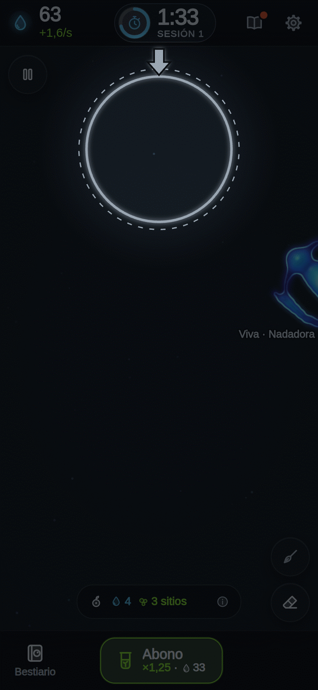

---

## Paso 0 · Abre el juego

<table>
<tr>
<td valign="top">

Verás a Bioluma brillar. **Toca la pantalla** para entrar.

La primera vez hay una **intro** corta. Si quieres ir directo, toca **«Saltar intro»**.

Te saluda **VELA**, el **monitor de cultivo MC-7** del laboratorio. **Toca su globo** para leer lo siguiente. Mientras VELA habla, **el reloj espera**.

¿Ya sabes jugar? Toca **«Saltar tutorial»**. Puedes repetirlo cuando quieras desde **Ajustes**.

</td>
<td width="254" align="center" valign="top">

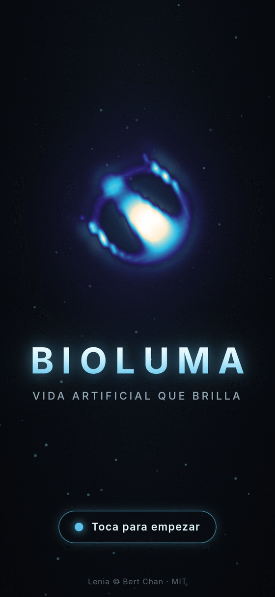

</td>
</tr>
</table>

---

## Paso 1 · Toca «Sembrar» 🌱

<table>
<tr>
<td valign="top">

La **placa** es el círculo oscuro del medio. En la primera sesión está **vacía**.

Abajo está el botón **Sembrar**. **Tócalo.** ¡Acabas de poner una **semilla de luz**! El juego busca solo el sitio libre más seguro. Si quieres elegirlo tú, **arrastra** la semilla desde el botón.

Tu primera semilla es **gratis** y vive seguro.

Arriba, en el centro, está el **reloj** de la sesión: **0:15**. Empieza a correr cuando VELA termina de hablarte de tu primera semilla.

**Tocar la placa no siembra nada.** Así nunca gastas sin querer.

</td>
<td width="254" align="center" valign="top">

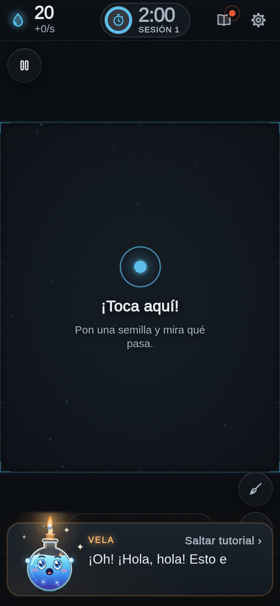

</td>
</tr>
</table>

---

## Paso 2 · Mira cómo nace

<table>
<tr>
<td valign="top">

La primera vez que pasa algo nuevo, VELA te lo explica con una tarjeta. Toca **«¡Entendido!»** para seguir.

Encima de cada semilla verás **«Naciendo 62 %»**. Si se queda con forma, ¡es una **criatura**! Dirá **«Viva»**.

Algunas semillas no prenden. **Es normal.** Si una no prende, **te devuelve lo que costó**. Y tras dos que no prenden seguidas, la siguiente **vive seguro** (los puntitos del botón Sembrar te lo cuentan).

</td>
<td width="254" align="center" valign="top">

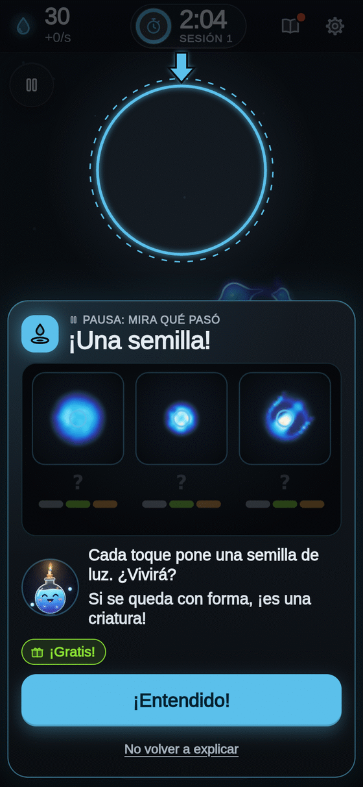

</td>
</tr>
</table>

---

## Paso 3 · Recoge la Luz 💧

Cada criatura viva llena **su propia gota de Luz**. Cuando la gota está llena, **tócala** o **pasa el dedo** por encima: la Luz vuela a tu contador, arriba a la izquierda.

**La Luz nunca se pierde.** Si se te escapa una gota, se recoge sola al sonar «¡Tiempo!». Más adelante, las **pipetas** de la ruta ↓ Recoger del Árbol la recogen por ti.

**«+1/s»** quiere decir **1 de Luz cada segundo**.

Con Luz siembras más. **Una semilla cuesta 4 de Luz**, siempre igual durante toda la sesión. Algunas son **gratis**: el botón te lo dice.

En la placa caben **3 criaturas** al principio. Si está llena, el botón dice **«Llena (3 de 3)»**. La ruta **Placa** del Árbol da más sitio.

---

## Paso 4 · Toca tus criaturas: el Pulso ✦

Tocar una **criatura viva** le da un **Pulso**: brilla, te da Luz al momento y recoge su gota.

- Los toques seguidos forman una **racha**: mientras dura, **toda** la Luz que entra vale más. Verás **«Racha +25 %»**.
- Cada **10 toques seguidos**, ¡un **Chispazo**! Vale **×5**. Desde la sesión 2 suelta **chispitas**: atrápalas antes de que se apaguen (si no, se quedan como gotas en la placa).
- Si paras un momento, la racha **baja poco a poco**, no de golpe.
- Tocar el agar vacío o una mancha sin forma **no da nada**, pero tampoco cuesta nada.

¿No te apetece tocar? **No pasa nada**: quien no toca nunca gana menos que antes. Tocar es un premio, no una obligación.

---

## Paso 5 · Cuida tus criaturas ⚠️

Las criaturas nadan, giran y a veces **chocan**. Si dos se tocan, **se funden** y pierden la forma.

- VELA **avisa antes de un choque** cuando todavía puedes hacer algo.
- **Arrastra el dedo desde una nadadora** para desviarla un poco.
- Si una criatura muere, **deja su Luz** en la placa. Y la primera vez que ves cada tipo de accidente, VELA te explica por qué pasó y te da **Datos**.

Si la placa se llena de materia sin forma, verás **«¡La placa se desbordó!»**. Toca **«Limpiar placa»** y sigue.

---

## Paso 6 · El reloj ⏱

<table>
<tr>
<td valign="top">

El reloj marca tu **tiempo de laboratorio**. La primera sesión dura **15 segundos** de juego; la ruta **Reloj** del Árbol las alarga hasta **2:30**.

- Cada **especie nueva** suma **+3 segundos**.
- Cerca del final el reloj se pone ámbar y cuenta los últimos segundos.
- Al llegar a **0:00**, la placa se para: **«¡TIEMPO!»**.
- El reloj **se para** mientras VELA habla o tienes una hoja abierta (Bestiario, Ajustes, una ficha…).

**No pierdes nada.** Tu Luz se cuenta y se vuelve Datos.

</td>
<td width="254" align="center" valign="top">

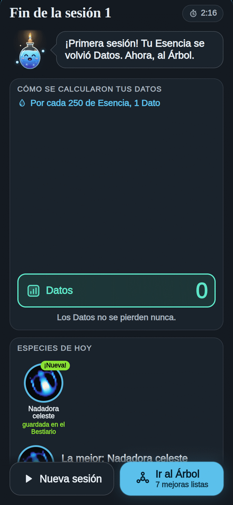

</td>
</tr>
</table>

---

## Paso 7 · Tu Luz se vuelve Datos 📊

<table>
<tr>
<td valign="top">

Al final de cada sesión, una tarjeta hace la cuenta paso a paso:

- **Por cada 25 de Luz, 1 Dato.**
- **+10 Datos** por cada especie nueva y **+2** por cada variante nueva.
- **+3 Datos** por cada manera de moverse nueva.
- **+2 Datos** por cada encargo cumplido.
- **+2 Datos** por cada **récord**.
- Cada noche nueva suma un poco más, y una sesión nunca da menos de **3 Datos**.

**Los Datos no se pierden nunca.** Tus especies nuevas quedan **guardadas en el Bestiario**.

Luego toca **«Ir al Árbol»**.

</td>
<td width="254" align="center" valign="top">

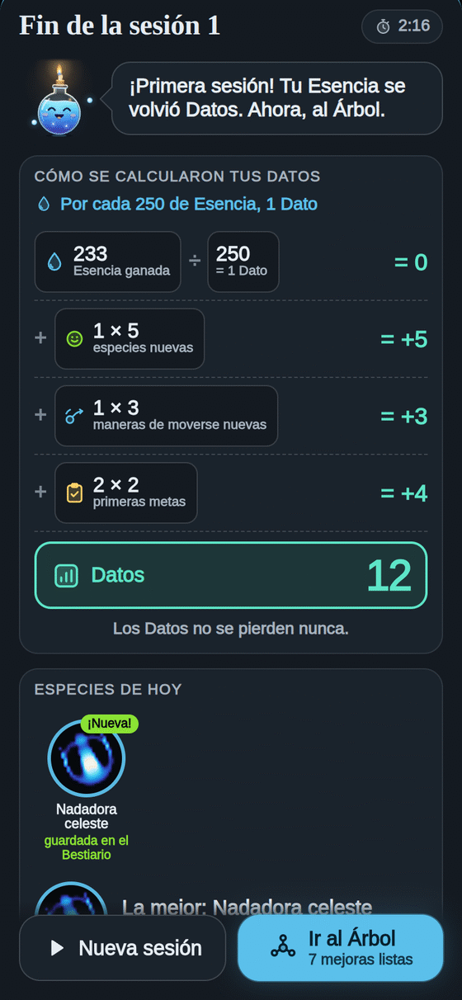

</td>
</tr>
</table>

---

## Paso 8 · Mejora el Árbol 🌳

<table>
<tr>
<td valign="top">

En el **Árbol** gastas tus Datos. Tiene **8 rutas rectas** que salen del centro.

Las mejoras que **laten en verde** las puedes comprar. **Toca una.**

Verás **«Ahora → Con un nivel más»**: lo que tienes y lo que tendrás. Toca **«Comprar»**.

Cada mejora es **tuya para siempre**. La próxima sesión ya lo notas.

Todo sobre las mejoras: [[Árbol]].

</td>
<td width="254" align="center" valign="top">

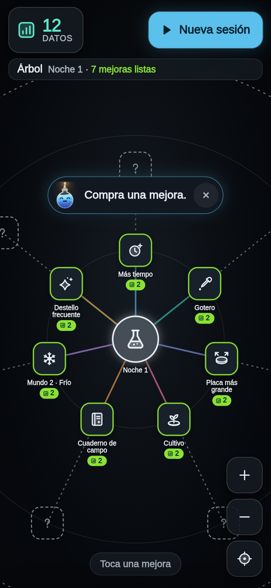

</td>
</tr>
</table>

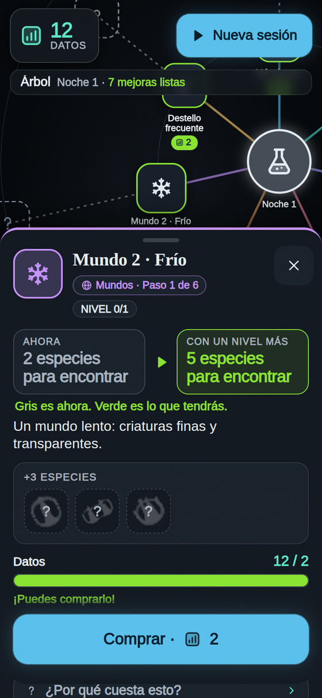

---

## Paso 9 · Una sesión nueva

<table>
<tr>
<td valign="top">

Toca **«Nueva sesión»**. Una tarjeta te dice:

- cuánto tiempo tienes hoy,
- qué te **regala el Árbol** (Luz de bolsillo, semillas de regalo, criaturas de la Nevera),
- lo **nuevo** desde la última vez,
- y tu **encargo**.

Mientras lees, la criatura de la **Nevera** ya va despertando en la placa.

Cuando tengas otro **Mundo**, elige su tarjeta: otras reglas, otras criaturas. Mira [[Mundos]].

Toca **«¡Empezar!»**. Desde la sesión 2, **el reloj empieza con tu primera semilla**.

</td>
<td width="254" align="center" valign="top">

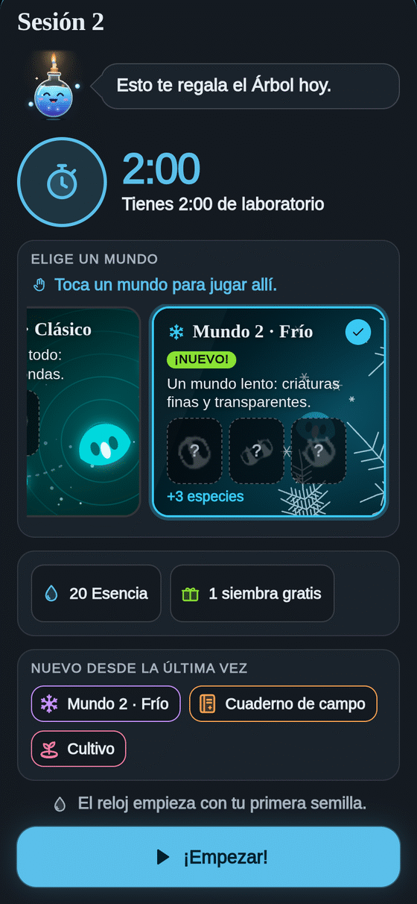

</td>
</tr>
</table>

---

## Paso 10 · Nutrientes, encargos y el Destello

<table>
<tr>
<td valign="top">

**Nutrientes 🌿** (el botón del centro, abajo, desde la sesión 2). Cuando el reloj lleva unos segundos, se enciende: **toda la Luz vale ×1,25 hasta el final de la sesión**. Su precio se fija cuando sale a la venta y solo se dobla con cada compra. Sin criaturas vivas dice **«Falta vida»**, y en los últimos segundos ya no se vende.

**Encargos** (desde la sesión 2). VELA te pide favores en la barra de arriba de la placa: «Ten 3 criaturas vivas a la vez». Cumplirlo da Luz, **+2 Datos** y **+3 segundos** de reloj.

**El Destello ✨** (desde la sesión 4). A veces una chispa dorada cruza la placa. **¡Tócala rápido!** Te regala **10 segundos de tu Luz**, y tu próxima semilla vivirá seguro.

</td>
<td width="254" align="center" valign="top">

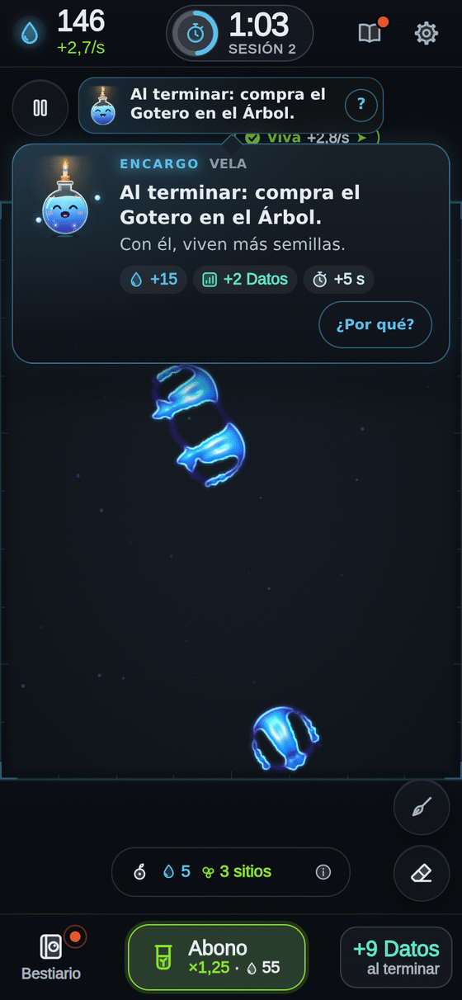

</td>
</tr>
</table>

---

## Paso 11 · El Bestiario 📖

<table>
<tr>
<td valign="top">

El botón **Bestiario** está abajo a la izquierda. Ahí se guarda **cada especie** que descubres, para siempre.

Toca una para ver su ficha: su retrato, su nombre, **cómo se mueve**, **dónde vive** y **cuánta Luz da**. También puedes **mantener el dedo** sobre una criatura de la placa para ver su ficha.

Más en [[Especies]].

</td>
<td width="254" align="center" valign="top">

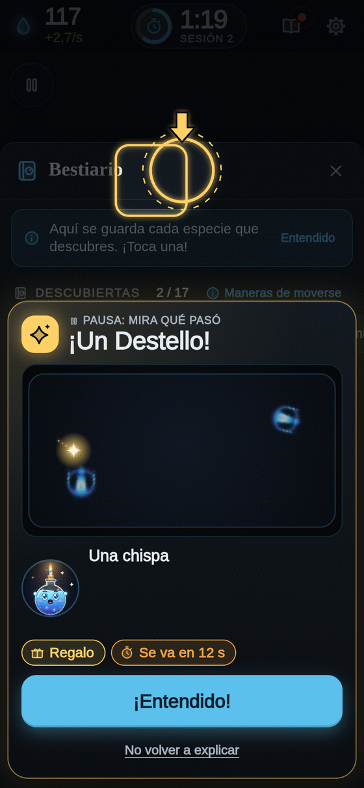

</td>
</tr>
</table>

---

## Paso 12 · La noche avanza 🌙

Después de unas sesiones y unas especies, **el centro del Árbol brilla en dorado**: ¡la noche puede avanzar!

Tócalo. **No se borra nada.** Se abren mejoras nuevas y cada noche da **más Datos**. Todo en [[Noche]].

---

## La pausa ⏸

<table>
<tr>
<td valign="top">

El botón de **pausa** (arriba a la izquierda de la placa) para la placa **y el reloj**.

Toca **«Seguir»** para volver. Si quieres acabar ya, **«Terminar ahora»** te dice cuántos Datos te llevas antes de confirmar.

</td>
<td width="254" align="center" valign="top">

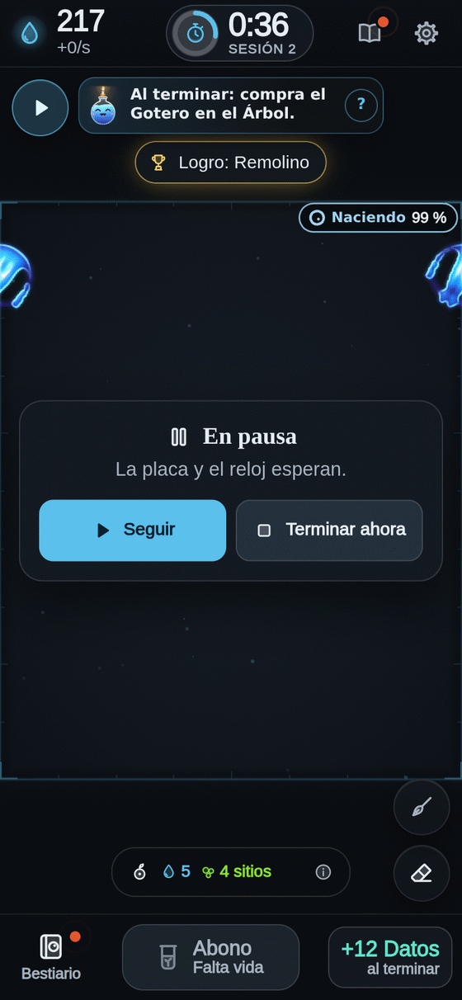

</td>
</tr>
</table>

---

## Trucos 💡

- **Recoge las gotas llenas** y **toca tus criaturas seguido**: la racha sube toda la Luz que entra.
- **Deja que el botón Sembrar elija el sitio.** Busca el hueco más seguro, lejos de las demás.
- **¿Una semilla no prendió?** No perdiste nada: te devolvió su precio.
- **Compra primero lo que late en verde.** El **Gotero** hace que vivan más semillas; **Más tiempo** alarga cada sesión; **Pipeta** recoge la Luz por ti.
- **Los mundos nuevos traen especies nuevas**: cada especie nueva da Datos y segundos de reloj.
- **Nada se pierde**: ni la Luz, ni los Datos, ni el Árbol, ni el Bestiario.

Más preguntas: [[Preguntas frecuentes]].
