[[Español|Cómo-jugar]] · **English**

# How to play

It is very easy! You only need **one finger**.

Bioluma is played in short lab **sessions**, with a **clock**. In each session you sow life with the **Sow** button and gather **Glow**: the creatures keep it in drops and you collect it with your finger. At the end, your Glow becomes **Data**, and Data grows the **Tree**. The next session earns more. And the one after that, even more!

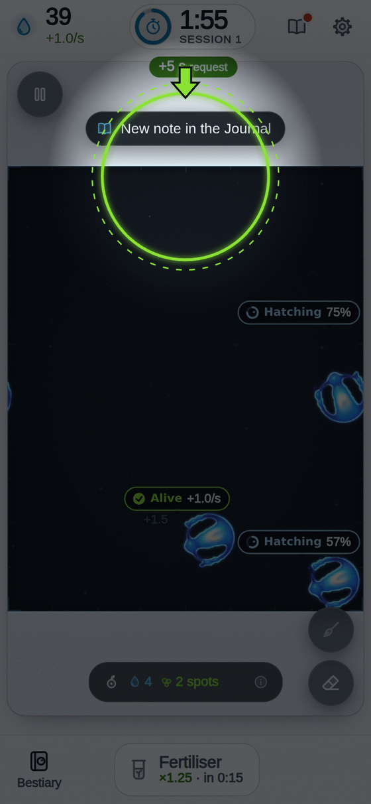

---

## Step 0 · Open the game

<table>
<tr>
<td valign="top">

You will see Bioluma glow. **Tap the screen** to come in.

The first time there is a short **intro**. To go straight in, tap **"Skip intro"**.

**VELA**, the lab's **MC-7 culture monitor**, says hello. **Tap her bubble** to read on. While VELA talks, **the clock waits**.

Already know how to play? Tap **"Skip tutorial"**. You can replay it any time from **Settings**.

</td>
<td width="254" align="center" valign="top">

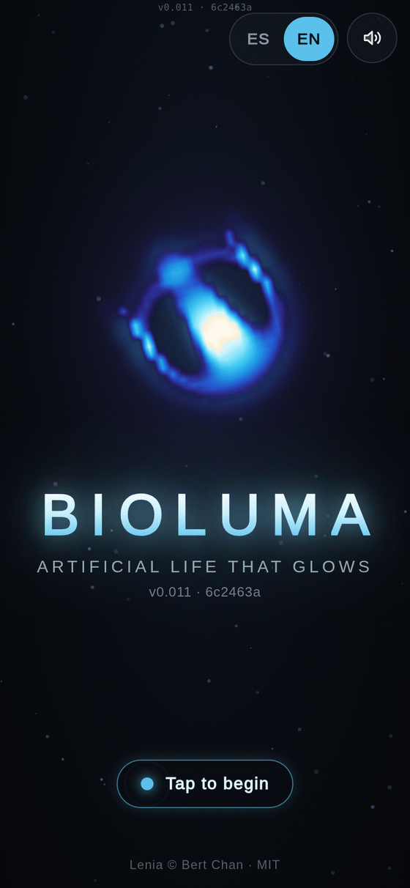

</td>
</tr>
</table>

---

## Step 1 · Tap "Sow" 🌱

<table>
<tr>
<td valign="top">

The **dish** is the dark circle in the middle. In the first session it is **empty**.

At the bottom is the **Sow** button. **Tap it.** You just dropped a **seed of light**! The game finds the safest free spot by itself. To choose the spot yourself, **drag** the seed from the button.

Your first seed is **free** and always lives.

At the top, in the middle, is the session **clock**: **0:15**. It starts once VELA has finished telling you about your first seed.

**Tapping the dish never sows.** You can never spend by accident.

</td>
<td width="254" align="center" valign="top">

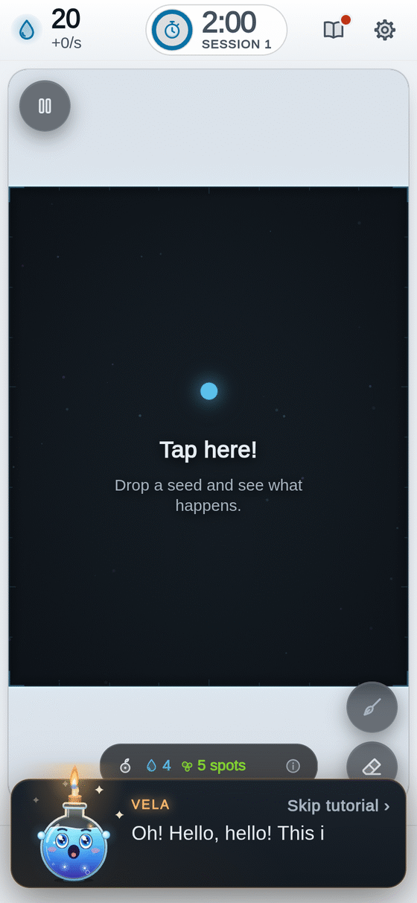

</td>
</tr>
</table>

---

## Step 2 · Watch it hatch

<table>
<tr>
<td valign="top">

The first time something new happens, VELA explains it with a card. Tap **"Got it!"** to go on.

Above every seed you will see **"Hatching 62 %"**. If it keeps its shape, it is a **creature**! It will say **"Alive"**.

Some seeds do not take. **That is normal.** A seed that does not take **gives back its price**. And after two misses in a row, the next one **surely lives** (the little dots on the Sow button tell you).

</td>
<td width="254" align="center" valign="top">

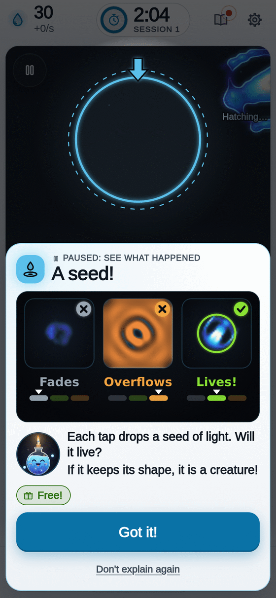

</td>
</tr>
</table>

---

## Step 3 · Collect the Glow 💧

Every living creature fills **its own drop of Glow**. When a drop is full, **tap it** or **swipe** over it: the Glow flies to your counter, top left.

**Glow is never lost.** If you miss a drop, it is collected by itself at "Time!". Later on, the **pipettes** of the ↓ Collect route in the Tree collect it for you.

**"+1/s"** means **1 Glow every second**.

Glow buys more seeds. **A seed costs 4 Glow**, the same price for the whole session. Some are **free**: the button tells you.

The dish holds **3 creatures** at first. When it is full, the button says **"Full (3 of 3)"**. The **Dish** route in the Tree gives more room.

---

## Step 4 · Tap your creatures: the Pulse ✦

Tapping a **living creature** gives it a **Pulse**: it shines, gives you Glow right away and collects its drop.

- Taps in a row build a **streak**: while it lasts, **all** the Glow that comes in is worth more. You will see **"Streak +25 %"**.
- Every **10 taps in a row**, a **Flash**! It is worth **×5**. From session 2 it throws out **glimmers**: catch them before they fade (if you don't, they stay on the dish as drops).
- If you stop for a moment, the streak **drains slowly**, never all at once.
- Tapping empty agar or a shapeless blob **gives nothing**, but costs nothing either.

Not in the mood for tapping? **That's fine**: a player who does not tap never earns less than before. Tapping is a reward, not a chore.

---

## Step 5 · Look after your creatures ⚠️

Creatures swim, spin and sometimes **collide**. If two touch, they **merge** and lose their shape.

- VELA **warns you before a collision** while you can still do something.
- **Drag your finger from a swimmer** to steer it a little.
- If a creature dies, **it leaves its Glow** on the dish. And the first time you see each kind of accident, VELA explains why it happened and gives you **Data**.

If the dish fills up with shapeless matter, you will see **"The dish overflowed!"**. Tap **"Clean dish"** and carry on.

---

## Step 6 · The clock ⏱

<table>
<tr>
<td valign="top">

The clock shows your **lab time**. The first session lasts **15 seconds** of play; the **Clock** route of the Tree stretches sessions up to **2:30**.

- Every **new species** adds **+3 seconds**.
- Near the end the clock turns amber and counts down the last seconds.
- At **0:00** the dish stops: **"TIME!"**.
- The clock **stands still** while VELA talks or a sheet is open (Bestiary, Settings, a species card…).

**You lose nothing.** Your Glow is counted and becomes Data.

</td>
<td width="254" align="center" valign="top">

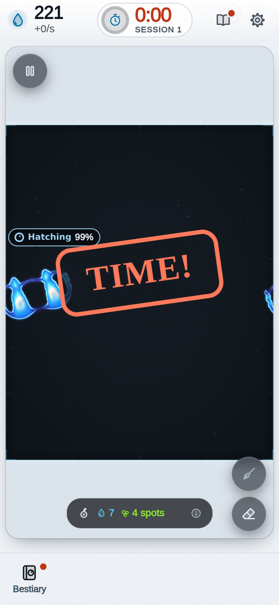

</td>
</tr>
</table>

---

## Step 7 · Your Glow becomes Data 📊

<table>
<tr>
<td valign="top">

At the end of every session, a card does the maths step by step:

- **For every 25 Glow, 1 Data.**
- **+10 Data** for each new species and **+2** for each new variant.
- **+3 Data** for each new way of moving.
- **+2 Data** for each request done.
- **+2 Data** for each **record**.
- Every new night adds a little more, and a session never gives less than **3 Data**.

**Data is never lost.** Your new species are **kept in the Bestiary**.

Then tap **"Go to the Tree"**.

</td>
<td width="254" align="center" valign="top">

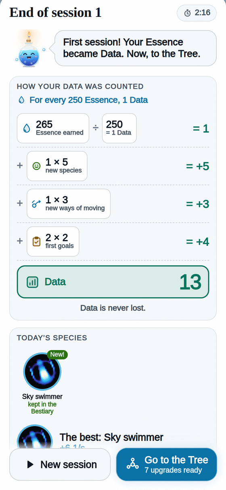

</td>
</tr>
</table>

---

## Step 8 · Grow the Tree 🌳

<table>
<tr>
<td valign="top">

The **Tree** is where you spend your Data. It has **8 straight routes** out of the centre.

Upgrades that **pulse green** are ones you can buy. **Tap one.**

You will see **"Now → With one more level"**: what you have and what you will have. Tap **"Buy"**.

Every upgrade is **yours forever**. You will feel it in the next session.

All about upgrades: [[Tree|Tree-en]].

</td>
<td width="254" align="center" valign="top">

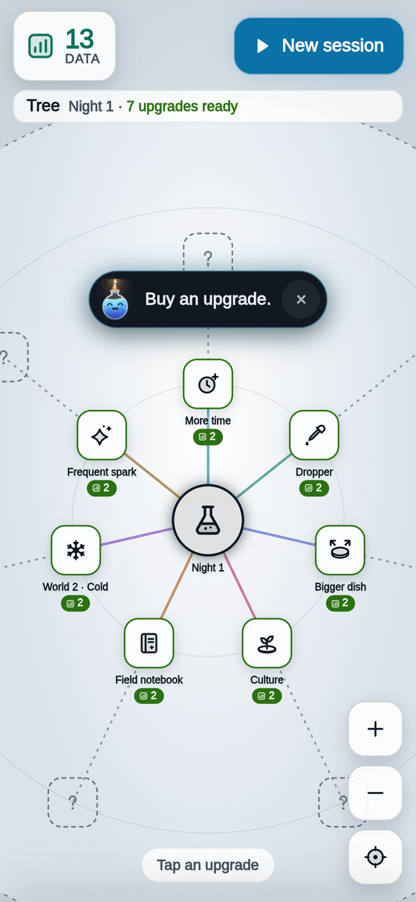

</td>
</tr>
</table>

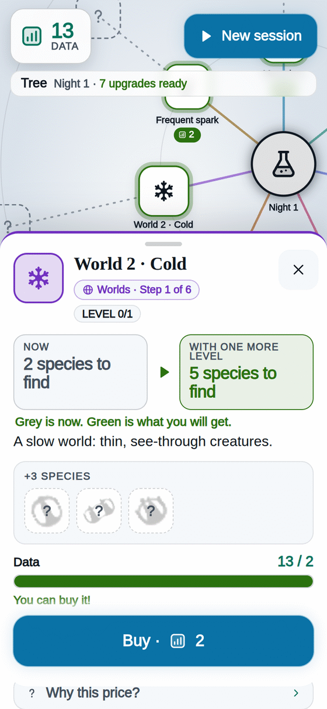

---

## Step 9 · A new session

<table>
<tr>
<td valign="top">

Tap **"New session"**. A card tells you:

- how much time you have today,
- what the **Tree gives you** (Pocket glow, gift seeds, creatures from the Fridge),
- what is **new** since last time,
- and your **request**.

While you read, the **Fridge** creature is already waking up on the dish.

Once you have another **World**, pick its card: other rules, other creatures. See [[Worlds|Worlds-en]].

Tap **"Let's start!"**. From session 2, **the clock starts with your first seed**.

</td>
<td width="254" align="center" valign="top">

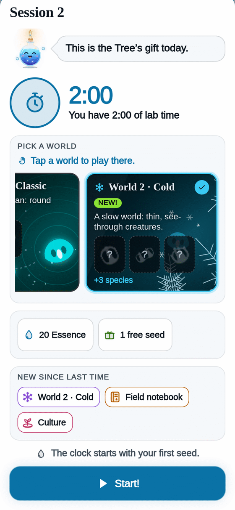

</td>
</tr>
</table>

---

## Step 10 · Nutrients, requests and the Spark

<table>
<tr>
<td valign="top">

**Nutrients 🌿** (the middle button at the bottom, from session 2). Once the clock has run a few seconds it lights up: **all Glow is worth ×1.25 until the end of the session**. Its price is set when it goes on sale and only doubles with each purchase. With nothing alive it says **"Needs life"**, and it is not sold in the last seconds.

**Requests** (from session 2). VELA asks for favours in the bar at the top of the dish: "Have 3 living creatures at once". Doing one gives Glow, **+2 Data** and **+3 seconds** of clock.

**The Spark ✨** (from session 4). Now and then a golden spark crosses the dish. **Tap it quickly!** It gives you **10 seconds of your Glow**, and your next seed will surely live.

</td>
<td width="254" align="center" valign="top">

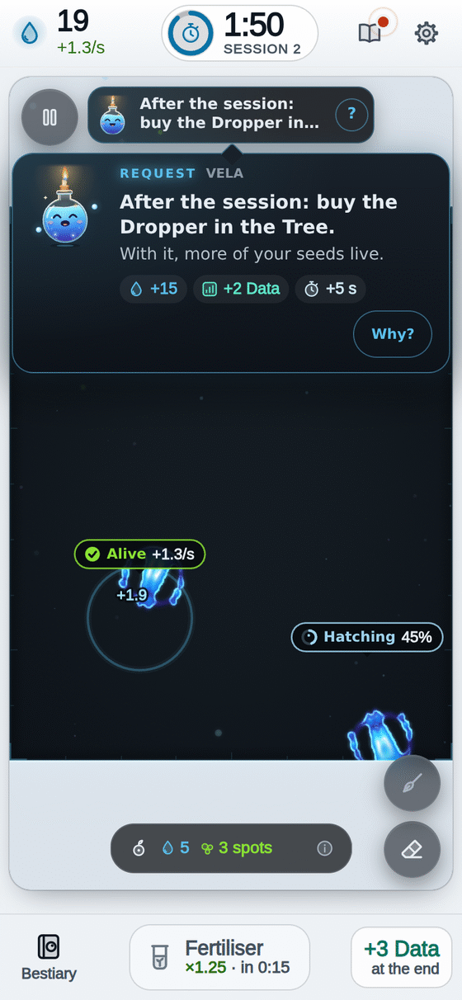

</td>
</tr>
</table>

---

## Step 11 · The Bestiary 📖

<table>
<tr>
<td valign="top">

The **Bestiary** button is at the bottom left. **Every species** you discover is kept there, forever.

Tap one to see its card: its portrait, its name, **how it moves**, **where it lives** and **how much Glow it gives**. You can also **hold your finger** on a creature in the dish to see its card.

More in [[Species|Species-en]].

</td>
<td width="254" align="center" valign="top">

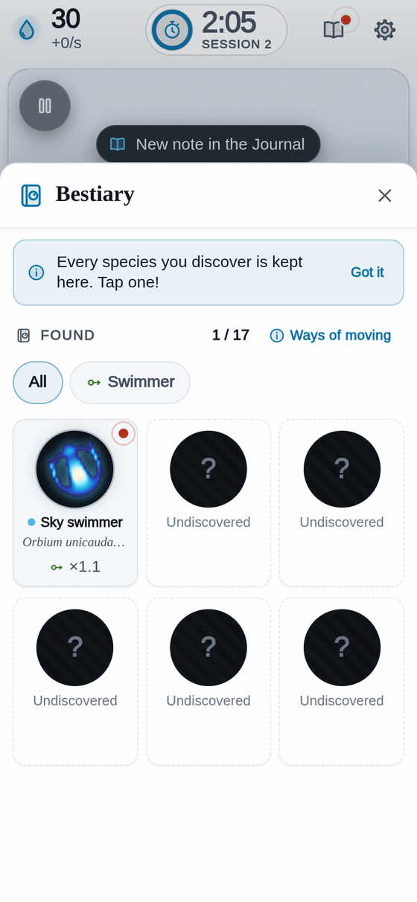

</td>
</tr>
</table>

---

## Step 12 · The night moves on 🌙

After a few sessions and a few species, **the centre of the Tree glows gold**: the night can move on!

Tap it. **Nothing is erased.** New upgrades open and every night gives **more Data**. All in [[Night|Night-en]].

---

## Pause ⏸

<table>
<tr>
<td valign="top">

The **pause** button (top left of the dish) stops the dish **and the clock**.

Tap **"Keep playing"** to go back. If you want to finish now, **"End now"** tells you how much Data you take before you confirm.

</td>
<td width="254" align="center" valign="top">

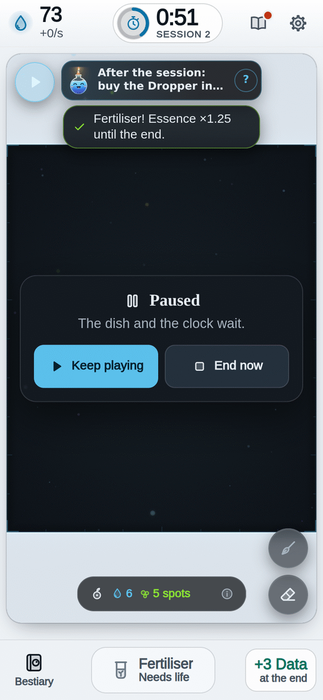

</td>
</tr>
</table>

---

## Tips 💡

- **Collect full drops** and **tap your creatures in a row**: the streak boosts all the Glow that comes in.
- **Let the Sow button pick the spot.** It looks for the safest gap, away from the others.
- **A seed did not take?** You lost nothing: it gave its price back.
- **Buy what pulses green first.** The **Dropper** makes more seeds live; **More time** makes every session longer; **Pipette** collects Glow for you.
- **New worlds bring new species**: each new species gives Data and clock seconds.
- **Nothing is lost**: not your Glow, not your Data, not the Tree, not the Bestiary.

More questions: [[FAQ|FAQ-en]].
