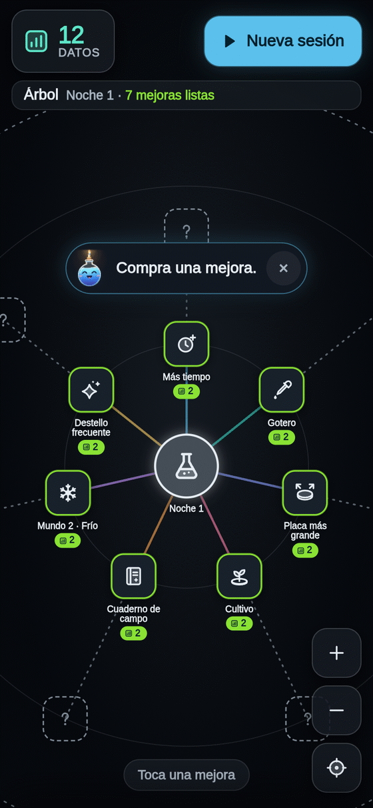
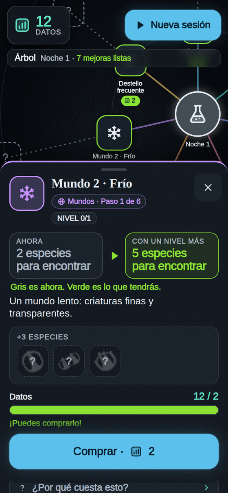

**Español** · [[English|Tree-en]]

# El Árbol 🌳

El **Árbol** es donde gastas tus **Datos**. Cada mejora es **tuya para siempre**: nunca se pierde.

## Cómo se usa

1. Al terminar una sesión, toca **«Ir al Árbol»**. Entre sesiones también está el botón **Árbol** abajo.
2. Las mejoras que **laten en verde** las puedes comprar ya.
3. **Toca una.** Su hoja dice qué hace con dos cajas: **Ahora** y **Con un nivel más**.
4. Toca **«Comprar»**. ¡Listo! La próxima sesión ya lo notas.

- **¿Por qué cuesta eso?** Toca **«¿Por qué cuesta esto?»** en la hoja: verás la cuenta.
- Cada nivel cuesta un poco más que el anterior.
- Los **«?»** son mejoras que aún no conoces: aparecen cuando compras la de antes.
- Algunas mejoras esperan a una **noche** nueva: lo dice su hoja. Mira [[Noche]].

## Los ocho caminos

Del centro salen **ocho caminos rectos**: 62 mejoras en total. Cada paso necesita solo el anterior.

| Camino | Qué mejora | Ejemplos |
|---|---|---|
| ⏱ **Reloj** | Más tiempo en cada sesión y un arranque más rápido | Más tiempo, Reloj grande, Nevera, Recta final, Encargos con prisa |
| 💧 **Gotero** | Viven más semillas y siembras más | Gotero, Luz de bolsillo, Semillas de regalo, Semillas fuertes, Sembrador automático |
| 🧫 **Placa** | Más sitio para criaturas | Placa más grande, Más sitio, Guardería, Incubadora |
| 🌱 **Vida** | Cada criatura da más Luz | Cultivo, Bordes nítidos, Superalimento, Nadadoras, Amistad, Vida eterna |
| ↓ **Recoger** | Pipetas que recogen la Luz por ti | Pipeta, Pipetas rápidas, Gotas grandes, Más pipetas, Pipetas con imán |
| 🔬 **Descubrir** | Más Datos por cada descubrimiento | Cuaderno de campo, Copiadora, Coleccionista, Archivo, Microscopio |
| 🌍 **Mundos** | Reglas nuevas con criaturas nuevas | Mundo 2 · Frío, Mundo 3 · Remolinos… Mira [[Mundos]] |
| ✦ **Pulso** | Tocar da más Luz, y la chispa dorada regala más | Pulso, Racha larga, Chispazo seguido, Destello frecuente, Regalos mejores |

## Consejos

- **Empieza por lo que más se nota:** el **Gotero** (viven más semillas), **Más tiempo** (sesiones más largas) y la **Pipeta** (recoge la Luz por ti).
- **Placa más grande** da sitio a más criaturas: más Luz a la vez.
- ¿Te gusta tocar? La ruta **✦ Pulso** hace que cada toque y cada racha den más.
- **Un mundo nuevo** trae especies nuevas, y cada especie nueva da **+10 Datos** y **+3 segundos** de reloj.
- ¿Te faltan Datos? La hoja te dice **cuántos** y **en cuántas sesiones** más o menos los tendrás.

Más: [[Cómo jugar]] · [[Noche]] · [[Mundos]]
